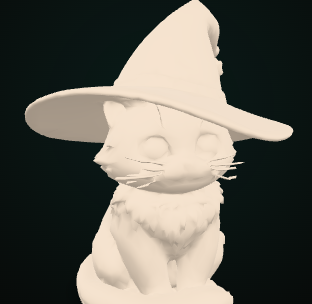
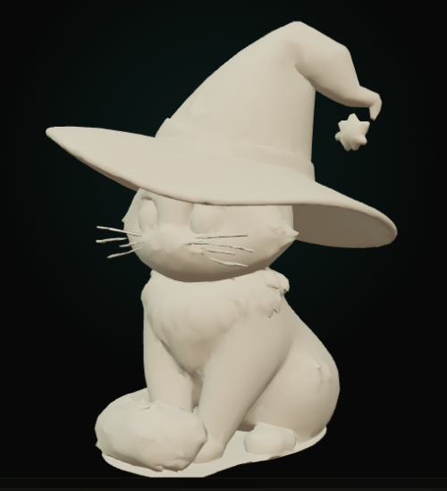
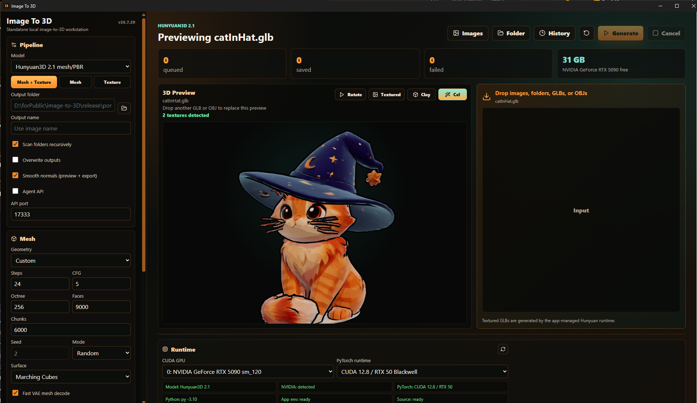
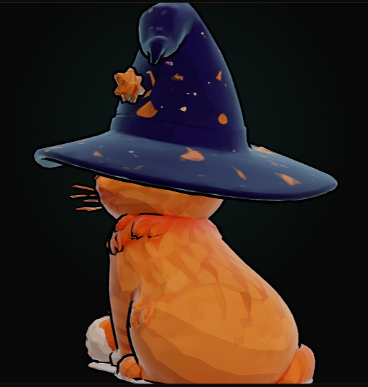
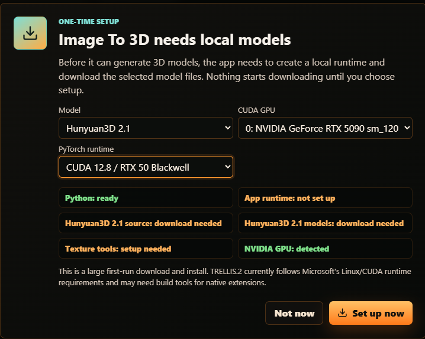

# Image To 3D

Image To 3D turns images into local 3D assets without opening ComfyUI. The
project is now organized around three supported 3D model families: Hunyuan3D,
TripoSplat, and TRELLIS.2.

| Backend | Output type | Status |
| --- | --- | --- |
| Hunyuan3D 2.1 | Mesh/PBR GLB, mesh-only GLB, texture-only GLB | Integrated |
| TripoSplat | Gaussian splats and point-cloud-style exports | Supported model family; Tauri backend integration next |
| TRELLIS.2 4B | O-Voxel/PBR GLB | Experimental integration |

## Example Output

| Shade smooth off | Shade smooth on |
| --- | --- |
|  |  |
| Original face shading exposes the low-poly facets. | Blender-style vertex-normal shading softens the surface without increasing the polygon count. |

*Both previews use the same generated mesh with approximately 9k triangles.*

### Textured Cel Preview



*A 9k-face Hunyuan3D mesh shown in the built-in Three.js viewer with smooth
normals, four-band Cel lighting, rim light, and ink-style contours.*

<p align="center">
  
</p>

*Rear detail showing how the Cel shader preserves the generated color texture
while simplifying the lighting and outlining the silhouette.*

The app is designed for NVIDIA GPUs. Hunyuan3D and TRELLIS.2 are large CUDA
workloads, and TripoSplat is also GPU-oriented; CPU generation is not a
supported target.

## For Humans

Use the app like a normal desktop tool.

1. Run the portable app:

   ```text
   release\portable\image-to-3d.exe
   ```

   Or run the installer:

   ```text
   release\installer\Image To 3D_26.8.16_x64-setup.exe
   ```

2. On first launch, the app checks what is already installed. If setup is
   needed, it asks before downloading models or installing packages.

   

3. Add an image or a folder of images. You can also drop a `.glb`, `.gltf`, or
   `.obj` file into the window to preview it without starting a generation job.
   Dropping another model replaces the current preview.

   A `.glb` can contain its materials and texture images inside the single GLB
   file, so an adjacent JPG is not required when the textures are embedded.
   OBJ uses separate sidecar files: keep its `.mtl` and referenced JPG/PNG
   textures beside the `.obj`. The app loads the matching MTL and base-color
   texture automatically and lets you switch the preview between `Textured`
   and `Clay`. GLB previews also offer `Cel`, which uses smooth normals, stepped
   lighting, rim light, and silhouette contours. Use `Pause`/`Rotate` to stop
   or resume the turntable. `Shade smooth (preview + texture/export)` updates
   the viewer immediately, uses smooth vertex-normal conditioning during
   Hunyuan texturing, and writes recalculated normals into generated GLBs.

4. Pick the CUDA GPU and PyTorch runtime in the Runtime panel if you have more
   than one NVIDIA GPU.

   - `CUDA 12.4 / stable` is the default and is known to work on cards like the
     RTX 3090.
   - `CUDA 12.8 / RTX 50 Blackwell` is intended for RTX 50-series cards such as
     the RTX 5090.
   - When an RTX 50-series card is detected, the app recommends CUDA 12.8 before
     setup or generation.
   - `Auto choose compatible GPU` uses the best compatible card for the
     installed runtime.

5. Choose a model backend:

   - `Hunyuan3D 2.1` supports mesh, mesh + texture, and texture-only workflows.
   - `TripoSplat` creates Gaussian splat outputs rather than polygon meshes.
     It is the splat-focused path for viewers and tools that understand native
     splat formats.
   - `TRELLIS.2 4B` generates a textured GLB through Microsoft's official
     TRELLIS.2 pipeline and currently follows its Linux/CUDA/native-extension
     requirements.

   TRELLIS.2 also depends on gated Hugging Face models. Before choosing
   `Prepare` for TRELLIS.2, sign in to Hugging Face with the account you use for
   the app and accept/request access for every required repo:

   - `microsoft/TRELLIS.2-4B`:
     https://huggingface.co/microsoft/TRELLIS.2-4B
   - `facebook/dinov3-vitl16-pretrain-lvd1689m`:
     https://huggingface.co/facebook/dinov3-vitl16-pretrain-lvd1689m
   - `briaai/RMBG-2.0`:
     https://huggingface.co/briaai/RMBG-2.0

   `RMBG-2.0` is required too; TRELLIS.2 uses it for background removal before
   reconstruction, so Prepare can still be blocked even after TRELLIS.2 and
   DINOv3 are accepted.

   If the app cannot access one of these gated repos, Prepare will stop with the
   exact link to accept. Use your own authorized Hugging Face token, for example
   through `HF_TOKEN` or `HUGGING_FACE_HUB_TOKEN`, when running the app or the
   headless runner.

6. For Hunyuan, choose a mode:

   - `Mesh + Texture` creates a textured GLB.
   - `Mesh only` creates a faster mesh preview GLB.
   - `Texture only` textures an existing `.glb`, `.gltf`, `.obj`, or `.ply`.

7. Pick geometry detail or TRELLIS resolution:

   - `Low poly` is the default and targets about 5k faces.
   - `Medium` targets about 20k faces.
   - `High` targets about 50k faces.

   TRELLIS.2 also has backend-specific presets:

   - `Preview / game-ready` uses the 512 pipeline, 20k faces, and a 1024 texture.
   - `Standard` uses the 1024 cascade, 100k faces, and a 2048 texture.
   - `Quality` uses 25 sampling steps, 200k faces, and a 2048 texture.
   - `High-poly` keeps up to 500k faces with a 4096 texture.

   TRELLIS subject cropping is enabled by default so a small subject is cropped
   before the official pipeline downsizes the full image. Exported GLBs are
   normalized to opaque materials and receive configurable UV-atlas gutter
   padding to reduce transparency artifacts and dark seams.

8. After generating or loading a `.glb`, `.gltf`, or `.obj`, open `Remesh` in the
   3D Preview to create clean quad topology with AutoRemesher. The first use asks
   before downloading the pinned AutoRemesher 1.1.0 Windows release and verifies
   its checksum. Target quads, edge scaling, sharp-edge angle, smooth-normal
   angle, adaptivity, and anisotropy are configurable. The original model is
   preserved; the geometry-only remeshed OBJ and a report are written beside it,
   and the 3D Preview switches to the new OBJ when processing finishes.

9. Generated GLBs go into an `output` folder beside the running app by default.
   If you choose a different output folder, the app remembers it.

### Hunyuan performance and VRAM guidance

`View resolution` is the size of every camera image processed by the Hunyuan
texture model (six views by default). It is separate from `Final texture`, which
controls the exported texture atlas. Increasing view resolution from 512 to
1024 doubles both dimensions, so the texture model processes four times as many
pixels and can take substantially more time and VRAM.

Start with:

- `View resolution`: 512
- `Final texture`: 2048
- `Low poly`: about 5k faces

As one RTX 5090 / CUDA 12.8 reference run, Hunyuan shape generation used about
11 GB of VRAM and geometry generation plus reduction took roughly 30 seconds.
The 512 texture-view stage used about 9.6 GB of VRAM. The complete job took
2m 04s, including 36.2s for texture generation. Treat these as observations,
not requirements or guarantees; GPU model, drivers, input, face target, texture
steps, and view count all affect memory use and runtime.

The app keeps loaded models warm after generation for faster follow-up jobs. Use
`Unload` in the Runtime panel when you want to release GPU memory.

The `History` view retains generation manifests across app restarts. Each
manifest records inputs, outputs, settings, per-image results, stage timings,
and elapsed time. After a preset completes successfully, its measured average
appears under the TRELLIS preset selector.

ComfyUI is not required. The app manages its own Python runtime, backend source
folders, model cache, and texture tools in app data.

After the rename to Image To 3D, an existing install may still use the legacy
`%APPDATA%\public.image.to.hunyuan3d` data folder. That is intentional: the app
reuses the old folder when it is already present so large model downloads do not
have to be repeated.

If you want an AI agent to control the app while the GUI is open, enable the
`Agent API` checkbox in the Pipeline panel. Most people can leave it off.

## For AI Agents

This repo is a Tauri 2 + React desktop app with a Python worker. Do not create
or commit a project `.venv`; the app creates its managed runtime under app data.

Managed app data contains:

- `python-env*` - app-owned Python environments for selected PyTorch runtime
  profiles.
- `runtime\Hunyuan3D-2.1` - downloaded Hunyuan source.
- `runtime\TRELLIS.2` - downloaded TRELLIS.2 source.
- `runtime\ComfyUI-Hunyuan3d-2-1-wheels` - Windows texture wheel source.
- `models` - Hugging Face model cache.
- `jobs` - per-run job files and temporary meshes.

Hunyuan preparation downloads/installs:

- Hunyuan source from `Tencent-Hunyuan/Hunyuan3D-2.1`.
- PyTorch CUDA wheels for Python 3.10-3.12.
- Curated Hunyuan inference dependencies.
- Prebuilt Windows texture wheels from `visualbruno/ComfyUI-Hunyuan3d-2-1`.
- Model weights from `tencent/Hunyuan3D-2.1`.
- Texture conditioning from `facebook/dinov2-giant`.
- `RealESRGAN_x4plus.pth` for texture enhancement.

TRELLIS.2 preparation downloads/installs:

- TRELLIS.2 source from `microsoft/TRELLIS.2`.
- Model weights from `microsoft/TRELLIS.2-4B`.
- Image conditioning weights from gated `facebook/dinov3-vitl16-pretrain-lvd1689m`.
- Background removal weights from gated `briaai/RMBG-2.0`.
- Basic TRELLIS.2 Python dependencies plus native extensions used by the
  official pipeline, including O-Voxel.

If an existing install was prepared before the shared Hunyuan/TRELLIS dependency
repair, run Prepare again for the selected backend. The app intentionally uses a
new runtime marker so the managed Python env can be repaired instead of reusing a
broken `transformers`/`diffusers` mix.

The TRELLIS GLB inspection/padding update adds `pygltflib` to its managed
environment. Existing TRELLIS installs therefore need one additional `Prepare`
run; existing model downloads are reused.

The gated Hugging Face dependencies are downloaded only after the user has
accepted their upstream access terms with their own Hugging Face account/token.
Do not bundle or redistribute gated model weights in app releases unless you
have explicit permission and the license/access terms allow it.

TripoSplat preparation downloads/installs:

- Model weights from `VAST-AI/TripoSplat`.
- TripoSplat pipeline code and dependencies for Gaussian splat generation.
- Native `.splat` / `.ply` style outputs, with point-cloud conversions where
  broader 3D-tool compatibility is needed.

The app intentionally skips full upstream demo/API/training dependencies such as
Gradio, FastAPI, Blender Python, Cupy, and Deepspeed.

Runtime profiles:

- `cu124` installs `torch==2.5.1+cu124`, `torchvision==0.20.1+cu124`,
  `torchaudio==2.5.1+cu124`. This is the known-good default for RTX 30/40-series
  cards and falls back to compatible GPUs when a newer card is not supported.
- `cu128` installs `torch==2.7.1+cu128`, `torchvision==0.22.1+cu128`,
  `torchaudio==2.7.1+cu128`. This is intended for RTX 50 / Blackwell GPUs.

Choosing a different CUDA GPU does not delete files or reinstall packages; the
worker only points CUDA at the selected card. Changing the PyTorch runtime
profile and choosing `Prepare` installs or reuses the managed Python environment
for that profile. Runtime profiles can live side by side, and `Reset Env`
removes only the selected Python runtime environment; models and outputs stay
untouched.

Generation logs include per-item elapsed time, coarse mesh timing, and texture
stage timings for mesh prep, UV unwrap, view render, multiview diffusion,
RealESRGAN enhancement, bake, inpaint, OBJ export, and GLB export.

### Build And Release

Prerequisites:

- Node.js 20.19+ or 22.12+
- Rust toolchain for Tauri builds
- Python 3.10, 3.11, or 3.12 available to the app
- NVIDIA GPU drivers with `nvidia-smi`

Install dependencies:

```powershell
npm install
```

Run the desktop app in development:

```powershell
npm run tauri:dev
```

Build and publish the standardized local release folders:

```powershell
npm run release:build
```

Release outputs:

- `release\portable\image-to-3d.exe`
- `release\installer\Image To 3D_26.8.16_x64-setup.exe`

### Headless Runner

Use the headless runner when the GUI should not be part of the automation flow:

```powershell
py -3 python\ih3d_headless.py --fast-preview D:\images\chair.png
```

Equivalent npm wrapper:

```powershell
npm run headless -- --fast-preview D:\images\chair.png
```

The runner uses the same managed runtime and model cache as the GUI. It streams
JSON worker events to stdout.

Useful flags:

- `--model-backend hunyuan` or `--model-backend trellis2` selects the backend.
- `--trellis-preset preview|standard|quality|highpoly|custom` selects a named
  TRELLIS quality profile.
- `--fast-preview` uses faster mesh-only settings.
- `--cuda-device 1` selects a specific NVIDIA GPU index.
- `--runtime-profile cu128` installs/uses the CUDA 12.8 RTX 50-series profile.
- `--mode meshTexture` creates mesh and texture.
- `--mode meshOnly` creates a faster mesh preview.
- `--mode textureOnly --mesh-input-path D:\mesh\source.glb` textures an existing
  mesh.
- `--output-dir D:\models` chooses the output folder.
- `--output-name chair-test` chooses the output basename.
- `--overwrite` replaces an existing output with the same name.

### Local Agent API

The GUI exposes a local-only Agent API when the user enables `Agent API` in the
Pipeline panel. The same API can be started on app launch by setting:

```powershell
$env:I3D_AGENT_API = '1'
.\release\portable\image-to-3d.exe
```

Automation can also start it explicitly by writing
`release\portable\output\agent-api-autostart.json` before launching the app:

```json
{
  "enabled": true,
  "port": 17333
}
```

The default port is `17333`. Change it in the Pipeline panel, or set
`I3D_AGENT_API_PORT` when using environment auto-start. The legacy
`IH3D_AGENT_API` and `IH3D_AGENT_API_PORT` names are still accepted for old
automation.

Default base URL:

```text
http://127.0.0.1:17333
```

Endpoints:

- `GET /health`
- `GET /openapi.json`
- `GET /status`
- `GET /history`
- `GET /runtime`
- `GET /vram`
- `POST /prepare`
- `POST /reset-runtime`
- `POST /unload-models`
- `POST /open-output-folder`
- `POST /open-runtime-folder`
- `POST /open-path`
- `POST /open-containing-folder`
- `POST /generate`
- `POST /cancel`

Use `/runtime?modelBackend=trellis2&runtimeProfile=cu128` to check a specific
backend/profile. `/status` includes `activeJob` while work is running and
`lastJob` after completion, including the final `status`, `message`, `outputs`,
`failedCount`, and `totalCount` fields.

The `/generate` endpoint accepts the same important settings the UI exposes.
Agents may send partial options; missing values are filled from app defaults.

Mode values:

- `meshTexture` - Mesh + Texture.
- `meshOnly` - Mesh only.
- `textureOnly` - Texture only.

Common options:

- `modelBackend`
- `cudaDevice`
- `runtimeProfile`
- `outputDir`
- `outputName`
- `meshInputPath`
- `overwrite`
- `meshDetail`
- `meshSteps`
- `meshGuidance`
- `meshSeed`
- `meshSeedMode`
- `octreeResolution`
- `numChunks`
- `reduceFaces`
- `maxFaces`
- `smoothNormals`
- `textureViewSize`
- `textureSteps`
- `textureGuidance`
- `textureSize`
- `textureSeed`
- `textureSeedMode`
- `trellisResolution`
- `trellisPreset`
- `trellisAutocrop`
- `trellisForceOpaque`
- `trellisAtlasPadding`
- `trellisSparseSteps`
- `trellisSparseGuidance`
- `trellisShapeSteps`
- `trellisShapeGuidance`
- `trellisTextureSteps`
- `trellisTextureGuidance`
- `trellisDecimationTarget`
- `trellisTextureSize`
- `trellisRemesh`
- `trellisExportWebp`

Geometry presets:

- `meshDetail = 'low'` targets about 5k faces and is the default.
- `meshDetail = 'medium'` targets about 20k faces.
- `meshDetail = 'high'` targets about 50k faces.

Hunyuan applies the target through `maxFaces` when `reduceFaces` is enabled.
TRELLIS.2 applies the target through `trellisDecimationTarget`.

Example fast mesh preview request:

```powershell
Invoke-RestMethod -Method Post -Uri http://127.0.0.1:17333/generate -ContentType 'application/json' -Body (@{
  paths = @('D:\images\chair.png')
  options = @{
    mode = 'meshOnly'
    cudaDevice = 'auto'
    runtimeProfile = 'cu124'
    outputDir = 'D:\models'
    outputName = 'chair-preview'
    overwrite = $true
    meshDetail = 'low'
  }
} | ConvertTo-Json -Depth 6)
```

Example full mesh + texture request:

```powershell
Invoke-RestMethod -Method Post -Uri http://127.0.0.1:17333/generate -ContentType 'application/json' -Body (@{
  paths = @('D:\images\chair.png')
  options = @{
    mode = 'meshTexture'
    cudaDevice = '0'
    runtimeProfile = 'cu128'
    outputDir = 'D:\models'
    outputName = 'chair-textured'
  }
} | ConvertTo-Json -Depth 6)
```

Example TRELLIS.2 textured GLB request:

```powershell
Invoke-RestMethod -Method Post -Uri http://127.0.0.1:17333/generate -ContentType 'application/json' -Body (@{
  paths = @('D:\images\chair.png')
  options = @{
    modelBackend = 'trellis2'
    cudaDevice = '0'
    runtimeProfile = 'cu128'
    outputDir = 'D:\models'
    outputName = 'chair-trellis'
    trellisTextureSteps = 12
    trellisExportWebp = $true
  }
} | ConvertTo-Json -Depth 6)
```

### Git Hygiene

Do not commit generated builds, local dependencies, app-managed Python
environments, downloaded source archives, model weights, copied GLBs, job files,
test output, or installer files.

The `.gitignore` covers:

- `node_modules`
- `dist`
- `release`
- `src-tauri/target`
- local Python caches
- generated mesh/model files
- app runtime/model/output folders
- test input/output folders
- installer files

## Texture Note

The supplied ComfyUI workflow, `Jun-2.1_TextureUpscaleWithAuraSR.json`, was used
as a reference for the intended product flow: mesh, multiview texture, upscale,
bake, inpaint, GLB.

The standalone worker currently uses Tencent's direct Hunyuan3D 2.1 Python API
for shape and PBR texture generation. AuraSR-specific parity is tracked as a
follow-up because the standalone app should not depend on ComfyUI custom node
loading.

## Roadmap

- Add explicit `/capabilities` and `/settings` endpoints for richer agent
  discovery.
- Add low-VRAM presets once they are validated.
- Add richer texture controls where Tencent's direct API exposes them.
- Add AuraSR-style optional view upscaling without requiring ComfyUI.
- Add thumbnails and turntable previews to the retained job history.

## Third-Party Notices

See `THIRD_PARTY_NOTICES.md` for attribution covering the TRELLIS subject crop,
UV-atlas padding, export inspection, preset, and manifest work adapted from
`dotneet/image-to-3d`.
